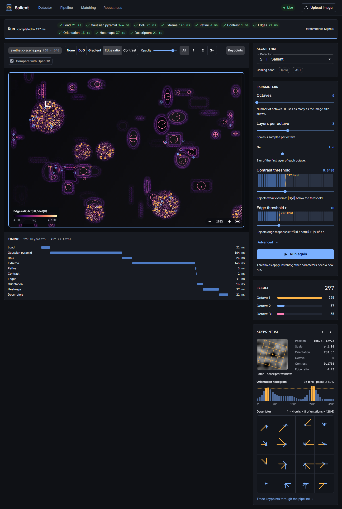
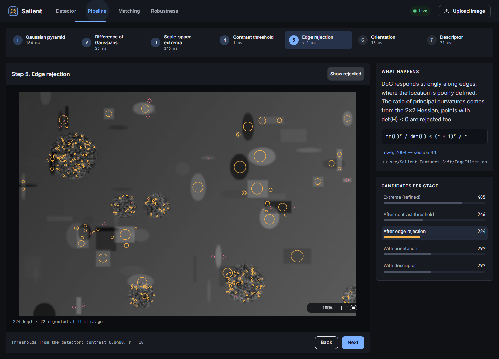
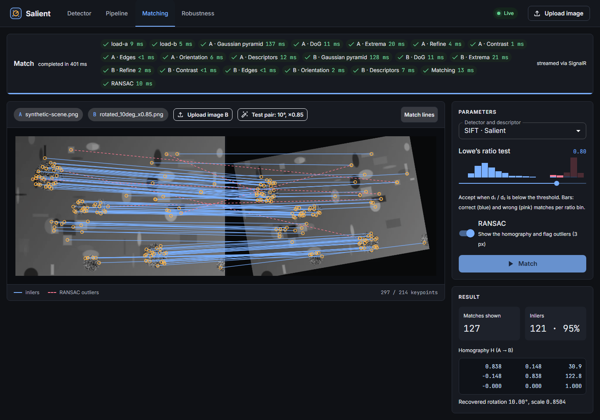
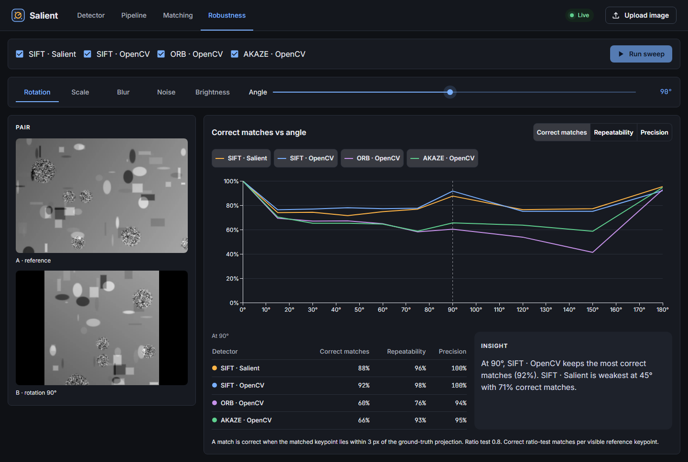

# Salient

An interactive workbench for feature detection and matching. With it you can:

- see every step of SIFT;
- inspect individual keypoints;
- match image pairs;
- measure how detectors hold up under rotation, scale, blur, noise and brightness changes.

Salient grows out of a 2019 bachelor's coursework project ([SIFTDetector](https://github.com/Xobnail/SIFTDetector)). It reimplements SIFT in C#, without the coursework's bugs, and verifies it against OpenCV. It wraps the algorithm in a .NET API with live progress over SignalR and a React + MUI frontend.



## Features

- **Detector:**
  - keypoints with scale, orientation and octave;
  - DoG, gradient, edge-ratio and contrast heatmaps;
  - contrast and edge thresholds that apply instantly, with "keypoints kept" histograms;
  - a keypoint inspector showing the patch, the 36-bin orientation histogram and the 4 × 4 × 8 descriptor;
  - a per-stage timing waterfall.
- **Pipeline:** steps through the Gaussian pyramid, DoG, extrema, contrast threshold, edge rejection, orientation and descriptor. For each step it shows the real intermediate images and the candidates kept and rejected.
- **Matching:**
  - brute-force k-NN with Lowe's ratio test and RANSAC homography;
  - a ratio histogram split into correct and wrong matches;
  - a one-click rotated test pair.
- **Robustness:** sweeps five transformation families and compares SIFT, ORB and AKAZE on repeatability, matching score and precision.
- **Compare with OpenCV:** Salient's SIFT next to `cv::SIFT` on the same image.

| Pipeline | Matching | Robustness |
|---|---|---|
|  |  |  |

## How it compares with OpenCV

Golden tests run Salient's SIFT and OpenCV 4.13 with the same parameters (`tests/Salient.Features.Sift.Tests/GoldenTests.cs`):

| Check | Result |
|---|---|
| Keypoint repeatability, both directions | 98.7% / 99.1% |
| Median orientation difference | 0.01° |
| Descriptor cosine similarity for the same keypoints | ≈ 1.000 |
| Correct matches on a pair rotated by 10° and scaled by 0.85 | 99.8% |

Performance on a 1 MP image (BenchmarkDotNet, Release):

| Operation | Time |
|---|---|
| SIFT detection | 36 ms (110 ms with upsampling) |
| SIFT detection + descriptors | 59 ms (142 ms with upsampling) |
| Brute-force matching, 2000 × 2000 descriptors | 8 ms |
| Full robustness sweep (5 families × 3 detectors, 900 × 600) | ~6 s |

## Architecture

```
src/
  Salient.Core               float images, separable SIMD convolution, resampling
  Salient.Features           detector/descriptor contracts, pipeline observation, diagnostics
  Salient.Features.Sift      SIFT: one class per stage (pyramid, DoG, extrema, refine, filters, orientation, descriptor)
  Salient.Matching           k-NN matching, ratio test, normalized DLT, RANSAC
  Salient.Evaluation         transformations with ground truth, repeatability and matching metrics
  Salient.Reference.OpenCv   OpenCvSharp adapters (SIFT, ORB, AKAZE) behind the same contracts
  Salient.Api                ASP.NET Core: jobs, SignalR, SQLite + blobs, WebP layers, SPA hosting
web/                         React, TypeScript, Vite, MUI, TanStack Query, generated API client
```

The decisions behind this are recorded in [docs/adr](docs/adr/README.md). The build order is in [docs/implementation-plan.md](docs/implementation-plan.md).

## Running

### With Docker

```bash
docker compose up --build
```

Then open http://localhost:8080. Data persists in the `salient-data` volume.

### For development

Requirements: .NET 10 SDK and Node.js 24.

```bash
dotnet run --project src/Salient.Api --launch-profile http
```

```bash
cd web && npm ci && npm run dev
```

Then open http://localhost:5173. The dev server proxies `/api` and `/hubs` to the API.

## Tests

```bash
dotnet test Salient.slnx
```

```bash
cd web && npm run lint && npm run typecheck && npm test && npm run e2e
```

- **Backend:** unit tests, synthetic SIFT scenarios, golden tests against OpenCV, matching and evaluation tests, API integration tests including SignalR, and an architecture test for the project dependency rules.
- **Frontend:** Vitest for the viewport math, hit-testing, schema-driven forms and filtering; Playwright for end-to-end flows.

Other useful commands:
- `npm run api:generate` regenerates the TypeScript client from `web/openapi/Salient.Api.json`. The API build writes that file.
- `npm run screenshots` refreshes the images in `docs/screenshots`.

## From the coursework

The 2019 implementation had several numerical bugs. Each one is now fixed and covered by a test:

- the DoG was taken with an absolute value, so it lost the sign that separates bright from dark blobs;
- the contrast threshold of 0.03 was applied to 0–255 intensities instead of 0–1;
- first derivatives were not halved, so the sub-pixel offset doubled;
- refinement iterated from the last step instead of the accumulated position;
- points with det(H) ≤ 0 survived edge rejection;
- Gaussian layers were blurred with a fixed 3 × 3 kernel and absolute (not incremental) σ.

## License

MIT; see [LICENSE](LICENSE). Third-party components are listed in [THIRD-PARTY-NOTICES.md](THIRD-PARTY-NOTICES.md). Sample images are generated procedurally; see [samples/README.md](samples/README.md).
